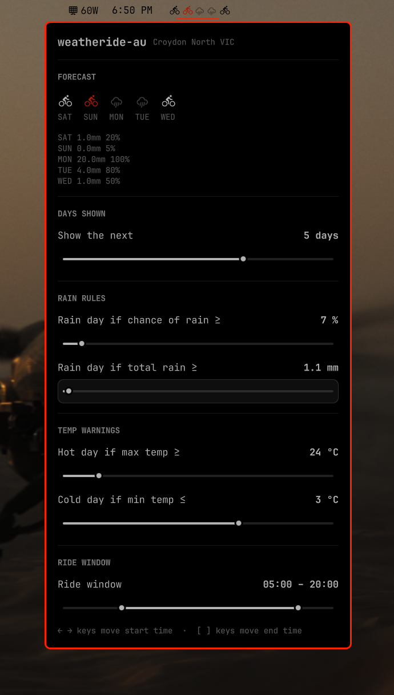

# weatheride-au

-----

Current version: **0.2.0**

Weatheride tells you, *whether* you should ride, on the upcoming days; using the Australian Bureau of Meteorology (BOM) data. Simply set your location, number of forward looking days (1-7), ride window times, rain, heat, and cold tolerance. Solves the need for scrolling through the hourly weather data of upcoming days to find out if it's a good day to commute or head out for a ride. 

This Project is based on [`zuccs omarchy-bom-weather`](https://github.com/zuccs/omarchy-bom-weather)



One glyph per day in the bar answers the question at a glance: which day is a good day to ride? 

- A **bike** is an ideal ride day
- A dimmed **rain** glyph; too wet to ride
- A **colored** bike; too hot to ride
- A **snowflake** glyph; too cold to ride

---

## Requirements

Omarchy Quattro (`with omarchy-shell`) 
An Australian location; the BOM forecasts Australia only
The BOM API data requites no account or API key

---

## Installation

```bash
omarchy plugin add https://github.com/junkyard82/weatheride-au.git --enable
```

The widget defaults to the center bar. Move it with `omarchy bar move` - or just drag and drop to a new location.

---

## Setup

Tell it where you are — a suburb, town or postcode:

```bash
omarchy bar set io.github.junkyard82.weatheride-au location "Brighton VIC"
```

For Example: Four states have a Brighton, so add the state ("Brighton VIC") or use the postcode ("3186") when a bare name is ambiguous; the first match wins. The name is resolved once against the Bureau's location search and cached indefinitely. Run the same line again to change location. Until a location is set, the bar shows the dimmed no-data dots and the panel surfaces the location setup hint.

---

## How it works

- Days are judged from tomorrow (today is never shown).
- **Near days** every hour of the configured window (default 06:00–20:00) is present, so the chance used is the **maximum hourly chance within the window** — "will it rain between 06:00 and 20:00?".
- **Far days**: BOM data may have no hourly data there, so the **whole-day** chance is used honestly.

---

## Settings

Settings are edited in the panel (rain chance, rainfall amount, max/min temp, ride window, day count), written on close to the widget's own config file:

```
~/.local/state/omarchy/settings/weatheride-au.json
```

The bar watches that file, so saved changes take effect immediately.

---

## Uninstall

```bash
omarchy plugin remove io.github.junkyard82.weatheride-au
```

That removes the plugin directory and its `shell.json` entry. 
To remove the response cache file:

```bash
rm -rf ~/.local/state/omarchy/weatheride-au ~/.local/state/omarchy/settings/weatheride-au.json
```

---

## How it behaves

- **Cached, politely.** The last good response is cached in `~/.local/state/omarchy/weatheride-au/` (mode `0600`) by the bundled `bin/bom-api` bridge. If the network is down, the cached data stays and a retry is armed.
- **No cached data on first load.** A cold start keeps the dimmed no-data dots until a **live** fetch succeeds. From then on last-good survives outages.
- **Polling interval** First fetch 30s after start (boot network race), then every 2h. On failure: retry every 1 min.

---

## Privacy & security

- The only network endpoint is `https://api.weather.bom.gov.au` — the public, keyless API behind the Bureau's own app and website. Nothing about you is sent beyond the location you configured; there is no IP geolocation. The only file written is the response cache above.
- The API is unofficial, undocumented, and its responses carry a BOM copyright notice reserving the data service. It has been around for years and an ecosystem of open-source clients reads it, but there is no guarantee it will be round in the future. The bridge sends an honest User-Agent and the refresh cadence keeps usage well below what the BOM app itself generates.
- `bin/bom-api` is ~400 lines of bash. Read it before you enable the plugin, as with any Omarchy plugin.
- Omarchy plugins run in the user's shell process and are not sandboxed.

---

## Credits

Based on [`zuccs omarchy-bom-weather`](https://github.com/zuccs/omarchy-bom-weather)
`bin/bom-api` is forked from the MIT-licensed [`io.github.zuccs.bom-weather`](https://github.com/zuccs/omarchy-bom-weather) plugin (attributed in LICENSE); 
Not affiliated with the Bureau of Meteorology or Omarchy. 
Weather data © Commonwealth of Australia, Bureau of Meteorology.

MIT — see [LICENSE](LICENSE)